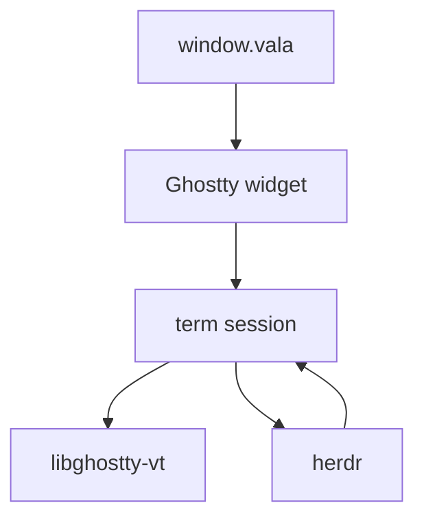
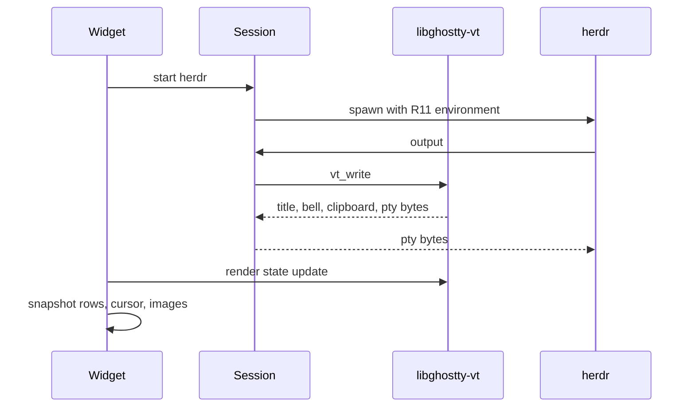
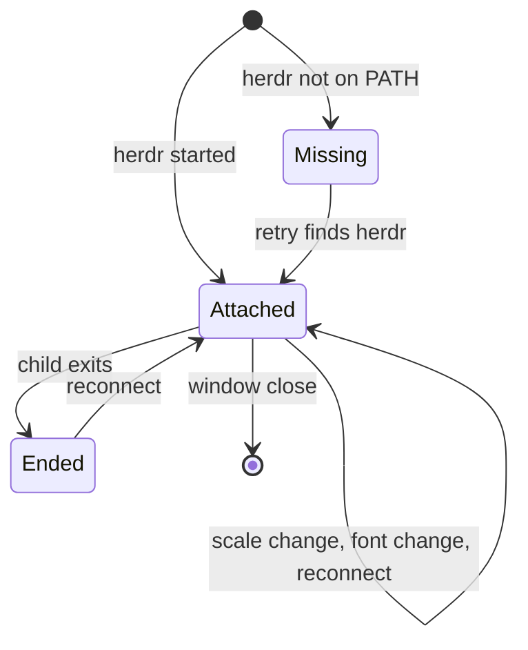

# Depend on libghostty-vt - Plan

## Goal Capsule

- **Objective:** A person using Corral gets the same Herdr window they get today, including how the terminal looks and how the session starts and ends.
- **Means:** Link libghostty-vt 1.0.0 and let Corral own the pty and the drawing (KTD1, KTD2, KTD3).
- **Authority:** R1 through R14 win on behavior. KD1 and KD2 constrain those requirements. A KTD wins on mechanism inside the requirements it cites. A unit overrides neither.
- **Execution profile:** Record the current child environment, scrollback limits, and scroll bytes before deleting the embed. Prove the new widget against that record. After the vendor tree is gone, smoke the Arch package, the AppImage, and the Flatpak.
- **Stop conditions:** Stop if the new window only matches by linking or patching Ghostty application code. Stop if a scale change or an output move starts a second herdr.
- **Who finishes:** Implementation lands on the `libghostty` branch. The user ships it.

## Product Contract

### Summary

Corral keeps the same window and the same Herdr session. Terminal state comes from libghostty-vt 1.0.0. The Ghostty application checkout, the GTK embed patch, and the static application library leave the build.

### Problem Frame

The window is a patched copy of Ghostty 1.4.0's application library. That library draws the frame, owns the pty, and reads the user's Ghostty config. Upstream declined a Linux embed of that library and replaced the terminal engine with libghostty-vt, which does not draw and does not spawn a process. The next Ghostty application release would be another fork. People using Corral still need the window they have now.

### Key Decisions

- **Depend on libghostty-vt. Do not vendor or patch Ghostty application code.** (session-settled: user-directed — chosen over keeping the v1.4.0 static embed and GTK patch: the window should link the stable terminal library.) Governs R13, R14.
- **No end-user-visible change.** (session-settled: user-directed — chosen over a thinner terminal or a cell grid that looks different: the window, Herdr, and the terminal should look and act as they do now.) Governs R1, R2, R3, R4, R5, R6, R7, R8, R9, R10, R11, R12.
  Conflict: libghostty-vt 1.0.0 does not return the OpenGL frames `src/ghostty-widget.c` blits today. The requirement stands. KTD3 is the mechanism, and bitwise equality with that readback is not available.

### Requirements

**Session**

- R1. Closing the window detaches from Herdr and does not stop the Herdr server.
- R2. The missing-herdr page and the session-ended page stay as they are, including the child's exit status.
- R3. Starting the terminal unsets every `HERDR_*` variable except `HERDR_SOCKET_PATH` and `HERDR_CONFIG_PATH`, then starts `herdr` in the current directory.
- R4. A scale change or a move between outputs keeps the same pty and the same herdr process.

**Appearance and history**

- R5. Font family and size follow Corral's settings, including the current fallback list, and a font change does not start a new child.
- R6. Every Ghostty 1.4 option that changes the embedded terminal follows the user's config and theme files. Font family, font size, and keybinds stay on Corral's overrides. Options that only configure Ghostty's own window, tabs, or splits are ignored.
- R7. Scrollback follows the user's `scrollback-limit-bytes`, `scrollback-limit-lines`, and the old `scrollback-limit` name. When unset, the byte limit is 50 MB and the line limit is unlimited, matching Ghostty 1.4.

**Input**

- R8. While the terminal is attached, clipboard chords stay in the window and every other key goes to the child. Window shortcuts do not run in that state.
- R9. Mouse buttons, scroll, selection, primary paste, URL clicks, and copy match the current window.
- R10. OSC 52 copy and paste still use the clipboard text. There is still no confirm dialog.

**Child process**

- R11. The child receives the same environment the current embed sets, and `herdr` is not wrapped in a shell.
- R12. Title, bell, open-URL, and the process-exited line behave as they do now.

**Build and packages**

- R13. The build fetches the libghostty-vt 1.0.0 release tarballs and does not clone or patch the Ghostty application.
- R14. The Arch package, the AppImage, and the Flatpak still produce a working Corral. Arch still depends on `ghostty-shell-integration` and does not install a second copy of those scripts.

### Actors

- A1. The person using the window.
- A2. The Herdr server, which stays up when the window closes.
- A3. The `herdr` process Corral starts.

### Key Flows

- F1. Start
  - **Trigger:** Corral opens a window.
  - **Actors:** A1, A3
  - **Steps:** If `herdr` is missing, show the missing-herdr page and leave window shortcuts active. If it is present, strip the nested Herdr variables per R3, start `herdr`, and attach the terminal.
  - **Outcome:** One herdr client, or the existing missing-herdr page.
  - **Covered by:** R2, R3
- F2. Paint and resize
  - **Trigger:** Output arrives, the widget resizes, the scale changes, or the font setting changes.
  - **Actors:** A1, A3
  - **Steps:** Feed output to the terminal. Draw from render state, including cell-sized box drawing from KTD3. While the widget is focused and blink is on, schedule the cursor phases. On scale or output change, keep the pty. On font change, update cell size and the pty window size on that same pty. On focus leave, stop the blink timer.
  - **Outcome:** The same session, with an updated grid.
  - **Covered by:** R4, R5
- F3. Keys, mouse, and clipboard
  - **Trigger:** A1 presses a key, drags, or a program asks for the clipboard.
  - **Actors:** A1, A3
  - **Steps:** Apply KTD6. Clipboard chords and OSC 52 stay in the window. Other input goes to the child.
  - **Outcome:** Herdr receives its chords. Copy and paste still work.
  - **Covered by:** R8, R9, R10
- F4. Exit and close
  - **Trigger:** The child exits, A1 closes the window, or A1 reconnects.
  - **Actors:** A1, A2, A3
  - **Steps:** On child exit, write the process-exited line into the terminal, paint that frame, then show the session-ended page with the status. On window close, close the pty master and do not signal the server. On reconnect, do that same close and then start one new herdr.
  - **Outcome:** Detach leaves the server up. Reconnect is a new client, not a second one beside the old pty.
  - **Covered by:** R1, R2, R12

### Acceptance Examples

- AE1. Scale keeps the session
  - **Covers:** R4
  - **Given:** Herdr is attached.
  - **When:** The widget's scale changes.
  - **Then:** The same herdr process is still running, and the grid size matches the new widget size.
- AE2. User theme
  - **Covers:** R6
  - **Given:** The user's Ghostty config sets `theme`.
  - **When:** The window attaches.
  - **Then:** The colors are that theme's colors, not a built-in palette that ignores the file.
- AE3. Attached keys
  - **Covers:** R8
  - **Given:** The terminal is attached.
  - **When:** A1 presses Ctrl+Q, then Ctrl+Shift+C.
  - **Then:** The window does not quit. The selection is copied.
- AE4. OSC 52 paste
  - **Covers:** R10
  - **Given:** The clipboard holds text Corral did not itself write, and the child requests that clipboard.
  - **When:** The request is handled.
  - **Then:** The child receives that text. The UI does not ask for confirmation.
- AE5. Child exit
  - **Covers:** R2, R12
  - **Given:** Herdr is attached.
  - **When:** The child exits with a status.
  - **Then:** The window shows the process-exited line and then the session-ended page with that status.
- AE6. Shell integration still available
  - **Covers:** R11, R14
  - **Given:** Herdr starts a bash, fish, or zsh.
  - **When:** That shell looks up Ghostty's integration scripts.
  - **Then:** It finds them, and Arch has not installed a second copy over `ghostty-shell-integration`.

### Scope Boundaries

- Corral stays a window for Herdr. Tabs, splits, and session management stay in Herdr.
- Ghostty's keybind file is not honored. R8 is the key policy.
- Sixel is out. The current image path that must keep working is Kitty graphics.
- Linking, patching, or building the Ghostty application is out.
- A distro `libghostty-vt` package is not required for this work. Switching the three packages to that shared library waits until the package exists.
- `libghostty-gtk4` is out. Upstream has not shipped one.

#### Deferred to Follow-Up Work

- Drop the bundled static library once a distro package can satisfy Arch, the AppImage base, and the Flatpak runtime.
- Revisit the painter if upstream ships a GTK drawing library.

### Sources

- Current embed: `src/ghostty-widget.c`, `src/window.vala`, `src/main.vala`, `patches/ghostty-gtk-embed.patch`, `scripts/sync-ghostty.sh`, `scripts/build-libghostty.sh`.
- Ghostty 1.4 scrollback defaults, 50 MB and unlimited lines: `third_party/ghostty/src/config/Config.zig` keys `scrollback-limit-bytes` and `scrollback-limit-lines`.
- libghostty-vt 1.0.0 docs: [installing](https://lib.ghostty.org/vt/installing.html), [rendering](https://lib.ghostty.org/vt/guide-rendering.html), [effects](https://lib.ghostty.org/vt/guide-effects.html), [input](https://lib.ghostty.org/vt/guide-input.html), [images](https://lib.ghostty.org/vt/guide-images.html), [stability](https://lib.ghostty.org/vt/stability.html).
- Release tarballs and the warning that a git tag archive builds the application: [PACKAGING-LIBGHOSTTY.md at vt-1.0.0](https://github.com/ghostty-org/ghostty/blob/vt-1.0.0/PACKAGING-LIBGHOSTTY.md).
- Linux embed of the application library was declined: [ghostty discussion 11722](https://github.com/ghostty-org/ghostty/discussions/11722).

## Planning Contract

### Key Technical Decisions

- KTD1. **Build a static libghostty-vt 1.0.0 from the signed release tarballs.** (session-settled: user-directed — chosen over keeping the v1.4.0 static embed and GTK patch: the window should link the stable terminal library.) Use `libghostty-vt-1.0.0.tar.gz` and `libghostty-vt-1.0.0-deps.tar.gz` from `release.files.ghostty.org`, Zig 0.17, and an empty `ZIG_GLOBAL_CACHE_DIR`. Link `libghostty-vt.a` into the `corral` executable. A private `libghostty-vt.so` would add a SONAME and a run path to the Arch package, the AppImage, and the Flatpak. Do not build the GitHub archive of tag `vt-1.0.0`. No distro package existed on 2026-11-07, and the AppImage and Flatpak bases cannot assume one. Cites R13, R14.
- KTD2. **Own the pty on the GTK main loop.** (session-settled: user-directed — chosen over keeping the v1.4.0 static embed and GTK patch: the library has no pty, so Corral keeps the one the window already had.) The master is non-blocking. A main-loop fd source feeds at most one chunk of output to `ghostty_terminal_vt_write` per dispatch, then returns so keys and paints can run. `GHOSTTY_TERMINAL_OPT_WRITE_PTY` copies its bytes into an outbound queue and returns. A `G_IO_OUT` watch drains that queue. Key and paste bytes use the same queue. Finish an OSC 52 read with a bounded nested main-loop iteration inside the clipboard callback, then reply before that callback returns. A change notification carries no bytes, so a cache is empty for text already on the clipboard at startup and for a foreign copy whose read has not finished. While that callback is on the stack, pause the pty fd source, skip render-state updates, queue resize and input, and hold the session so close or reconnect cannot free it. An empty reply is a failure of this path, not the design. Cites R3, R4, R10, R11.
- KTD3. **Draw with a GTK snapshot and Pango from render state.** (session-settled: user-directed — chosen over a thinner terminal or a cell grid that looks different: the session has to look like the current window.) Keep the Vala type `Corral.Ghostty`, its properties, and its signals. Change the GTK parent off `GtkGLArea` in the same edit that deletes the frame blit. Shape ordinary text with Pango. The render state exposes graphemes and row ids, and Corral already resolves the font fallback list with Pango. Draw U+2500 through U+259F, U+2800 through U+28FF, and U+E0B0 through U+E0BF per cell so Herdr pane borders join. Do not shape those ranges with Pango. An OpenGL glyph painter on the existing `GtkGLArea` would keep the realize and unrealize cycle and the process-wide desktop-GL pin, and it would still not recover the application renderer's readback. Paint cursor, selection, padding, and Kitty placements from the render state. While focused and blink is on, schedule the cursor on and off phases. Honor render holds, and call the render-state clean after a complete frame. Measure cell size at the widget scale and pass it to `ghostty_terminal_resize`.
  Conflict: the library returns graphemes and placements. The current frame is an OpenGL readback. Bitwise equality with that readback is not available. U5 removes that painter, so the side-by-side reference is captured from the old embed before U5. A failed look reverts U5. Cites R4, R5, R6, R9.
- KTD4. **Read the user's Ghostty config for appearance, and ship theme data with Corral.** (session-settled: user-directed — chosen over a thinner terminal or a cell grid that looks different: a theme name in the user's config has to keep working.) Read the same default config files the embed loads now. Apply every option R6 keeps. The Ghostty 1.4 checkout has no themes directory. Themes come from the `iterm2_themes` URL and hash in `third_party/ghostty/build.zig.zon`. Fetch that tarball once, record its license, and install the files into `data/ghostty-themes/`. Also honor a theme file the user already has beside their config, and `GHOSTTY_RESOURCES_DIR/themes` when that directory exists. Cites R5, R6, R7.
- KTD5. **Ship shell integration as Corral data.** (session-settled: user-directed — chosen over a thinner terminal or a cell grid that looks different: shells Herdr starts still have to find the scripts.) Copy the scripts the current build installs into `data/shell-integration/` before deleting the Ghostty tree. The libghostty-vt tarball does not contain them. Arch keeps `install_shell_integration=false` and `ghostty-shell-integration`. AppImage and Flatpak install Corral's copy. Point `GHOSTTY_RESOURCES_DIR` at the directory that install uses. When that directory is set, set `TERM` to `xterm-ghostty`, `COLORTERM` to `truecolor`, and `TERMINFO` to the terminfo directory beside it. Install the `xterm-ghostty` terminfo into that sibling for the AppImage and the Flatpak. On Arch the sibling is the system terminfo directory, so leave that database to the system. Compute `GHOSTTY_SHELL_FEATURES` the way the current embed does. One captured child environment is a fixture for that derivation, not a list of absolute paths to hard-code. Cites R11, R14.
- KTD6. **Keep today's key and mouse split on the session.** (session-settled: user-directed — chosen over a thinner terminal or a cell grid that looks different: Herdr chords and copy have to keep their current owners.) The host handles `copy`, `paste`, `ctrl+shift+c`, `ctrl+shift+v`, `shift+insert`, and `ctrl+insert`. Every other key is encoded and written to the pty. Shift held overrides mouse tracking so the user can select inside Herdr. Double-click selects a word, triple-click selects a line, and Shift-click extends the selection. Dragging past the edge scrolls the selection. The selection stays pinned to the text as output arrives. With mouse tracking off and Shift up, left-drag selects and release writes the primary clipboard. Middle click and Shift+Insert paste primary. Ctrl+Shift+V pastes the regular clipboard. Right click is a button. Ctrl+click opens the cell's URL. With tracking on and Shift up, buttons and motion go to the child and the session does not select. Scroll with tracking off moves the viewport. Scroll with tracking on accumulates that event's distance, precision flag, modifiers, and cell the way `ghostty_surface_mouse_scroll` does, then writes the sequence for that delta. One recorded notch is the fixture for the discrete case, not the sequence every event replays. Cites R8, R9, R12.

### High-Level Technical Design

The window stays the Vala shell in `src/window.vala`. A session object owns the pty, the `GhosttyTerminal`, and key, mouse, and clipboard policy. The widget owns paint and forwards input to the session. Those two used to be one Ghostty surface.

Startup and a later frame:

The attached terminal has one lifecycle. Unrealize is not exit.

### Sequencing

U1, U2, U7, U3, and U4 land while `src/ghostty-widget.c` still blits Ghostty frames. U5 is the cutover. It replaces the surface, the blit, and the GTK parent together, because a session beside the old surface would start a second herdr. U6 starts after AE1 through AE6 and the side-by-side Herdr look. The three package smokes run on the tree U6 produces, and they pass only when each exits 0 with no Ghostty application checkout. A failed look stops U6. A failed smoke after U6 reverts that commit and leaves the last GitHub release in place. `.github/workflows/release.yml` publishes only after the three package jobs succeed on a tag push. Do not push a `v*` tag until the look has been repeated on a window built from the same commit.

### Risks and Dependencies

| Risk | Why it matters | Mitigation |
| --- | --- | --- |
| Glyph hinting differs from Ghostty's atlas | A1 can see a different font even when the theme and size match | KTD3. The side-by-side look is captured before U5, not a pixel hash |
| Box drawing comes from the font | Herdr pane borders show gaps when the glyph is not cell-sized | KTD3 draws those ranges per cell |
| OSC 52 read re-enters the main loop | A paint, resize, or close during the clipboard wait can mutate or free the session | KTD2 pauses the pty source, queues resize and input, and holds the session until the callback returns |
| A large paste blocks or truncates | The pty buffer is a few kilobytes and the write now runs on the main loop | KTD2 queues outbound bytes and drains them when the master is writable |
| Wheel bytes differ from today's | The 1.0 mouse button enum has no wheel | KTD6 accumulates each event. One recorded notch is only the discrete fixture |
| Zig 0.17 cache crash | A cache that already holds package archives can abort the vt build | KTD1 uses an empty cache, separate from `scripts/fetch-ghostty-zig-deps.sh` |
| Theme name fails closed | Ignoring `~/.config/ghostty` changes the window for anyone with a theme | KTD4 |
| PNG Kitty images disappear | The images guide says the host installs a decoder. The announcement says Wuffs is compiled in | Install `GHOSTTY_SYS_OPT_DECODE_PNG` with the PNG library Corral already links. Do not assume the built-in decoder |
| U6 lands before the look | A tag publishes the Arch package, the AppImage, and the Flatpak together | U6 starts after AE1 through AE6 and the side-by-side look. The three smokes run on the tree U6 produces. A later failure reverts that commit and leaves the previous release installed |

### Deferred implementation notes

- The nested clipboard wait needs a timeout. The timeout value is chosen when the portal round trip is visible. On timeout the attempt fails visibly in the log and the child gets an empty reply. That empty reply is the failure path, not a second design.
- The `TERM` fallback when `xterm-ghostty` is missing is taken from the current embed's own fallback, then applied with KTD5's prefix rules.

## Implementation Units

### U1. Build libghostty-vt 1.0.0 beside the current embed

- **Goal:** Meson produces a static libghostty-vt 1.0.0 without cloning the Ghostty application.
- **Requirements:** R13
- **Dependencies:** none
- **Files:** `meson.build`, `scripts/build-libghostty-vt.sh`, `tests/libghostty-vt-version.c`, `tests/meson.build`
- **Approach:**
  - Fetch the 1.0.0 source tarball and the matching deps tarball.
  - Build with Zig 0.17, `--system` pointed at the deps tarball, and a new empty Zig cache.
  - Install the static archive and headers into the build prefix.
  - Leave `scripts/sync-ghostty.sh` and the widget link on `libghostty.a` until U6.
- **Execution note:** This is packaging. Prove the library builds, and leave the running window on the old embed.
- **Patterns to follow:** `scripts/build-libghostty.sh` for the Zig invocation and the CPU baseline. `scripts/fetch-zig.sh` for the Zig 0.17 pin.
- **Test scenarios:**
  - Happy path: the version test includes `ghostty/vt.h` and fails the build when the headers are older than 1.0.0.
  - Edge: a second configure reuses the unpacked tarballs and does not need a network fetch.
  - Failure: a Zig cache directory that already contains package archives is not the cache this script uses.
- **Verification:** The version test passes, and the existing widget still links the application archive.

### U2. Move shell integration and themes into Corral data

- **Goal:** Scripts and theme files live in the repo, so deleting the Ghostty tree does not remove them.
- **Requirements:** R6, R11, R14
- **Dependencies:** none
- **Files:** `data/shell-integration/`, `data/ghostty-themes/`, `data/meson.build`, `meson_options.txt`, `packaging/arch/PKGBUILD`
- **Approach:**
  - Copy the shell-integration scripts the current `data/meson.build` installs into `data/shell-integration/`.
  - Fetch the `iterm2_themes` tarball named in KTD4. Install those files into `data/ghostty-themes/` and record the license beside them. The Ghostty checkout has no themes directory to copy.
  - Keep `install_shell_integration` and its Arch opt-out. Point the option at `data/shell-integration`.
  - Install `xterm-ghostty` terminfo beside the resources directory for the AppImage and the Flatpak. Arch keeps using the system terminfo directory.
- **Execution note:** Prefer a packaging smoke over a unit test. The files are data.
- **Patterns to follow:** `data/meson.build` and the Arch `PKGBUILD` delete step.
- **Test scenarios:**
  - Happy path: a prefix install with the option left on contains `share/ghostty/shell-integration` and the theme files.
  - Edge: configuring with the option off installs neither the scripts nor a replacement from the Ghostty tree.
  - Integration: the Arch package build still depends on `ghostty-shell-integration` and still removes a bundled script copy.
- **Verification:** The installed tree no longer needs `third_party/ghostty/src/shell-integration` as its source.

### U3. Add a display-free terminal session

- **Goal:** A display-free session starts `herdr`, keeps one pty, and exits with the same status, with terminal state in libghostty-vt.
- **Requirements:** R1, R3, R4, R7, R11, R12
- **Dependencies:** U1, U2, U7
- **Files:** `src/term-session.c`, `src/term-session.h`, `tests/term-session-test.c`, `tests/meson.build`
- **Approach:**
  - Put the pty, the environment, the `GhosttyTerminal`, and the effect callbacks in `src/term-session.c`. Do not call it from `src/ghostty-widget.c` yet. A second session beside `create_surface` would start a second herdr.
  - Register write-pty, title, bell, clipboard, and the other effects the current action callback handles, before the child runs.
  - Apply every parsed R6 field when the session starts, including palette, cursor, padding, and blink. Set scrollback from the same parser. When the user set nothing, use the R7 defaults.
  - On child exit, write the process-exited line the current embed draws into the terminal grid, then report the status. Closing the master does not signal the server. The window's session-ended page stays in U5.
  - A scale-change entry point updates the pty window size and does not spawn again.
- **Execution note:** Capture one child from the current embed as the fixture KTD5 describes. The new session follows that derivation, not the captured absolute paths.
- **Patterns to follow:** `strip_nested_herdr_env`, `close_surface_cb`, and the `exited` idle path in `src/window.vala`.
- **Test scenarios:**
  - Happy path: a session whose command is `printf hi` exposes that text through the terminal, and the exit status is 0.
  - Happy path: with a resources directory set, the child gets `TERM=xterm-ghostty`, `COLORTERM=truecolor`, and `TERMINFO` beside that directory, and it does not contain `HERDR_ENV` when the parent had it set.
  - Edge: destroying the session after start closes the master and does not leave the child as a process that still has the pty.
  - Failure: a command that cannot exec reports a failed start and does not emit a successful attach.
  - Integration: an effect callback that writes to the pty does not call `vt_write`.
- **Verification:** `tests/term-session-test.c` covers the scenarios above without opening a window. `src/ghostty-widget.c` still blits the application renderer.

### U4. Move keys, mouse, and clipboard to the session

- **Goal:** The session applies KTD6, so tests can prove chord ownership before the widget switches.
- **Requirements:** R8, R9, R10, R12
- **Dependencies:** U3
- **Files:** `src/term-session.c`, `src/term-session.h`, `tests/term-input-test.c`, `tests/meson.build`
- **Approach:**
  - Encode keys and mouse with the library encoders after syncing them from the terminal. Keep this in the session, not in `src/ghostty-widget.c`. The widget still feeds the application surface until U5.
  - Apply KTD6 to session inputs. User paste chords return text to the caller. The caller writes them through terminal paste so bracketed paste still applies.
  - Implement KTD2's clipboard reply on the session's effect callback.
- **Execution note:** Before U5 deletes `ghostty_surface_mouse_scroll`, record one discrete wheel notch as the fixture KTD6 names. The session still generates each live event.
- **Patterns to follow:** `send_key`, `mods_from_controller`, and the clipboard callbacks in `src/ghostty-widget.c`.
- **Test scenarios:**
  - Happy path: Ctrl+Shift+C with a selection produces clipboard text and zero pty bytes.
  - Happy path: a plain letter produces pty bytes and no clipboard write.
  - Edge: Ctrl held with a printable key still encodes, matching the current `send_key` rule.
  - Edge: mouse tracking off, left press, move, release, selects and writes primary only.
  - Edge: mouse tracking on, the same gesture writes encoded mouse bytes and does not change primary.
  - Edge: Shift-drag with tracking on selects and writes primary, and double-click selects the word under the pointer.
  - Edge: a resize and a close that arrive during a pending OSC 52 read are queued or deferred until the callback returns.
  - Integration: pasting 1 MB into a child that reads slowly delivers every byte, and the outbound queue does not block the caller.
  - Failure: an OSC 52 read whose clipboard callback never arrives hits the timeout, logs, and replies empty.
  - Integration: a user Ctrl+Shift+V uses the async clipboard read and still brackets the paste when the terminal mode is on.
- **Verification:** The input tests pass without a display. The running window still uses the application surface.

### U5. Cut the widget over to the session

- **Goal:** The widget's one child is the U3 session, and the window draws that session instead of the application frame.
- **Requirements:** R1, R2, R4, R5, R6, R8, R9, R10, R12
- **Dependencies:** U2, U3, U4, U7
- **Files:** `src/ghostty-widget.c`, `src/ghostty-widget.h`, `src/ghostty-widget.vapi`, `src/window.vala`
- **Approach:**
  - In one edit, stop calling `ghostty_surface_new`, delete `upload_frame`, and change the GTK parent off `GtkGLArea`. `src/window.vala` keeps constructing `Corral.Ghostty` and setting the same properties.
  - Wire keys, mouse, and clipboard through the session using KTD6 and KTD2. Keep the capture-phase key controller.
  - Before this edit, capture the old embed at scale 1 and scale 2: Herdr with pane borders, the user's theme, each cursor style, a selection, and a Kitty PNG. Those captures are the side-by-side reference. This edit removes the old painter.
  - On each frame, update render state, honor a render hold, draw dirty rows with Pango, draw the KTD3 box-drawing ranges per cell, composite Kitty placements, paint the cursor from the session's blink phase, then clean the render state.
  - Install the PNG decode callback once, before other threads use the library.
  - Font changes rewrite cell size and send one window-size update on the same pty.
  - On child exit, paint the process-exited line already in the grid, then emit `exited` so the existing idle path shows the session-ended page. On unrealize, keep the session.
- **Execution note:** A failed look against the captured reference reverts this unit. Check AE1 through AE6 before U6.
- **Patterns to follow:** `write_font_overlay` for the family list and the size clamp. `apply_font` for updating a live session.
- **Test scenarios:**
  - Happy path: attaching with `herdr` on `PATH` starts one child, and the window shows that child's text.
  - Edge: a scale change after attach keeps the same child pid.
  - Edge: Ctrl+Q while attached does not quit, and Ctrl+Shift+C copies the selection.
  - Failure: a missing `herdr` still shows the missing-herdr page and does not open a pty.
  - Integration: a resize during a render hold ends the hold and the next frame uses the new grid size.
- **Verification:** A manual session shows the user's theme, the settings font, a cursor, and a Kitty PNG. The widget no longer calls `ghostty_surface_take_frame`.

### U7. Parse Ghostty appearance config

- **Goal:** Theme, cursor, padding, and scrollback limits come from the user's Ghostty config without the application library.
- **Requirements:** R5, R6, R7
- **Dependencies:** U2
- **Files:** `src/config-appearance.c`, `src/config-appearance.h`, `tests/config-appearance-test.c`, `tests/meson.build`
- **Approach:**
  - Parse the options R6 keeps, plus the scrollback keys in R7. Resolve `theme` through KTD4, including a theme file beside the user's config.
  - Ignore font, keybind, and options that only configure Ghostty's window, tabs, or splits. Font family and size stay on Corral's settings.
  - Do not link this parser to the widget. U3 reads it when a session starts.
- **Patterns to follow:** `sanitize_font_family` in `src/settings.vala`, and the way `tests/settings-test.vala` compiles settings without the widget.
- **Test scenarios:**
  - Happy path: a config with `theme = <name>` and a matching file in `data/ghostty-themes/` yields that theme's background and foreground.
  - Happy path: `scrollback-limit = 1234` sets the byte limit to 1234.
  - Edge: a font-family key in the Ghostty file is ignored.
  - Edge: an unknown key is ignored.
  - Failure: a `theme` name with no file falls back to Ghostty 1.4's built-in background, foreground, and palette, and the missing name is logged.
- **Verification:** `tests/config-appearance-test.c` passes without a display and without `third_party/ghostty`.

### U6. Remove the Ghostty application embed

- **Goal:** The tree no longer clones, patches, or links Ghostty's application library.
- **Requirements:** R13, R14
- **Dependencies:** U1, U2, U5
- **Files:** `meson.build`, `src/meson.build`, `scripts/sync-ghostty.sh`, `scripts/build-libghostty.sh`, `scripts/fetch-ghostty-zig-deps.sh`, `patches/ghostty-gtk-embed.patch`, `src/main.vala`, `README.md`, `packaging/arch/PKGBUILD`, `packaging/appimage/build.sh`, `packaging/appimage/smoke-docker-inner.sh`, `packaging/flatpak/dev.corral.Corral.json`, `packaging/flatpak/smoke-docker-inner.sh`, `packaging/arch/smoke-docker-inner.sh`
- **Approach:**
  - Delete the sync script, the application build script, and the GTK patch. The frame blit is already gone in U5.
  - Point the three packages and their smoke scripts at the U1 tarball build and the U2 data files. The Flatpak smoke downloads both 1.0.0 tarballs on the host, before `flatpak-builder`, and the sandboxed build reuses those unpacked trees. It stops calling `scripts/sync-ghostty.sh` and `scripts/fetch-ghostty-zig-deps.sh`.
  - Drop link libraries that only the application renderer needed.
  - Rewrite the README build section so it describes the vt tarballs and Zig 0.17.
- **Execution note:** Do not start until AE1 through AE6 and a side-by-side Herdr look have passed. The three smokes are a go only when each exits 0 and the artifact exists, from a tree with no Ghostty application checkout. Do not push a `v*` tag until that look has been repeated on a window built from the same commit.
- **Patterns to follow:** The current package scripts' Zig fetch and offline Flatpak layout.
- **Test scenarios:**
  - Happy path: configure on a machine with no `third_party/ghostty` finishes and links `libghostty-vt.a`.
  - Edge: `src/main.vala` does not require the GL-only environment once the widget no longer uses a GL area.
  - Integration: the Arch, AppImage, and Flatpak builds complete without cloning `github.com/ghostty-org/ghostty`.
- **Verification:** `meson test` passes, and the three package smokes complete. A clean tree has no Ghostty application checkout and no GTK embed patch.

## Verification Contract

| Check | Command or action | Proves |
| --- | --- | --- |
| Unit and widget-free tests | `meson test -C build --print-errorlogs` | U1, U3, U4, U5 scenarios that do not need a display |
| Existing settings and herdr tests | same meson test run | Font clamp and the missing-herdr path still pass |
| Manual window | Attach Herdr, change scale, change font, copy with Shift-drag, paste, open a URL, watch the cursor blink, compare Herdr pane borders with the pre-U5 captures, exit the child, then start bash, fish, or zsh and confirm the integration scripts resolve | AE1 through AE6, and the side-by-side look KTD3 requires |
| Arch, AppImage, Flatpak | `packaging/arch/smoke-docker.sh`, `packaging/appimage/smoke-docker.sh`, `packaging/flatpak/smoke-docker.sh` | R14 |

## Definition of Done

- R1 through R14 hold on a built window, not only on the tests.
- AE1 through AE6 have been checked.
- U6 has removed the Ghostty application checkout, the GTK patch, and the frame blit.
- Abandoned painter experiments are not left in the tree.
- The README matches the build a new checkout actually runs.
